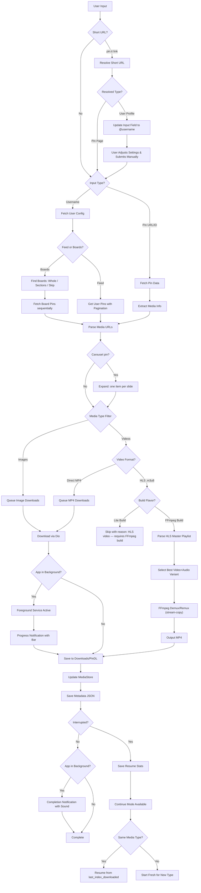

<div align="center">


# PinDL

<small>A personal-use utility app for downloading publicly accessible Pinterest content.</small>

[](https://dart.dev/)
[](https://flutter.dev/)
[](https://kotlinlang.org/)
[](https://developer.android.com)
[](LICENSE)
[](https://android-arsenal.com/api?level=24)

<br>
<small>Current release: <b>3.1.1</b> · <a href="RELEASE_NOTES.md">release notes</a> · <a href="CHANGELOG.md">changelog</a></small>

</div>

PinDL is a Flutter-based Android application that allows users to download publicly accessible images and videos from Pinterest. It supports downloading content from: **Individual Pins** (`URL` or `PIN ID`), **User Profiles** (Bulk download from any public `Pinterest username`), and **Boards** (whole board or selected sections). Multi-image (carousel) pins download every slide. The app features a beautiful Neumorphism (Soft UI) design with both light and dark themes.

- See also the CLI version of the same tool built using Node.JS: [motebaya/pinterest-js](https://github.com/motebaya/pinterest-js)

## How It Works



## Features

> [!IMPORTANT]
> **Feature full Explanation & Demo**: [See Here](SHOWCASE.md)

| Feature                              | Status |
| ------------------------------------ | ------ |
| Download from Pinterest username     | ✅     |
| Download single pins via URL         | ✅     |
| Download single pins via pin ID      | ✅     |
| Board downloads with sections (Whole / Sections / Skip) | ✅ |
| Short URL resolution (pin.it)        | ✅     |
| Image download support               | ✅     |
| Multi-image (carousel) pins — one indexed file per slide (`_image_1..n`) | ✅ |
| Video download support (720p)        | ✅     |
| HLS video conversion (FFmpeg build)  | ✅     |
| Best-quality rendition selection (direct MP4 over HLS, images upgraded to `/originals/`) | ✅ |
| Lite build: direct-MP4 videos; HLS-only videos require the FFmpeg build | ✅ |
| Batch/bulk downloads                 | ✅     |
| Background downloads (foreground service) | ✅ |
| Progress notifications with bar      | ✅     |
| Completion notifications with sound  | ✅     |
| In-app console: selectable logs, copy-all, HLS capability banner, Verbose-log detail | ✅ |
| Resume interrupted downloads         | ✅     |
| Cross-session progress accumulation  | ✅     |
| Per-media-type continue mode         | ✅     |
| Task state persistence (Hive)        | ✅     |
| Interrupted-task prompt on relaunch (Hive-backed) | ✅ |
| Metadata saving (JSON)               | ✅     |
| Skip existing files                  | ✅     |
| Overwrite mode                       | ✅     |
| Light theme                          | ✅     |
| Dark theme                           | ✅     |
| Download history                     | ✅     |
| Extraction history                   | ✅     |
| MediaStore integration (Android 10+) | ✅     |
| Video preview playback               | ✅     |
| Continue from last position          | ✅     |

## Documentation

- [Getting Started](docs/getting-started.md)
- [Usage](docs/usage.md)
- [Downloads](docs/downloads.md)
- [Boards](docs/boards.md)
- [Troubleshooting](docs/troubleshooting.md)
- [Architecture](docs/architecture.md) (contributor)
- [Development](docs/development.md) (contributor)

## Project Structure

```
lib/
├── core/                  # Pure Dart: no widgets, no platform channels
│   ├── config/            # Build-time feature flags (ENABLE_FFMPEG)
│   ├── constants/         # App constants and Pinterest API config
│   ├── exceptions/        # Custom exception classes
│   ├── media/             # Rendition selection + carousel slots
│   ├── network/           # Host allowlist, retry/backoff, byte-range resume
│   ├── persistence/       # Metadata schema v2, task/board resume
│   ├── theme/             # App themes and Neumorphism styles
│   ├── utils/             # Filename/folder helpers, URL validation
│   └── validation/        # Byte-signature content validation
├── data/
│   ├── controllers/       # ExtractionController, BoardController, DownloadCoordinator
│   ├── models/            # Data models (Pin, Author, Board, BackgroundTaskState, etc.)
│   ├── parsers/           # Pinterest HTML/JSON parsers
│   ├── pinterest/         # Request construction (resource registry)
│   └── services/          # API, download, HLS, notification, and history services
├── presentation/
│   ├── pages/             # UI screens (Home, Downloads, History, About, etc.)
│   ├── providers/         # Riverpod state management + foreground service manager
│   ├── utils/             # Motion + user-facing error message mapping
│   └── widgets/           # Reusable Soft UI widgets (boards picker, console)
└── main.dart              # App entry point (Hive init)

android/
├── app/
│   ├── src/main/
│   │   ├── kotlin/        # Kotlin code (MainActivity, MediaChannelHandler, BootPluginAssert)
│   │   └── res/drawable/  # Notification icons (ic_download_notification)
│   └── build.gradle.kts   # Android build configuration (flavors, core library desugaring)
└── key.properties         # Signing configuration (not in git)
```

> Orchestration: `presentation/providers` owns the state machine (job/
> extraction/download), and `data/controllers` holds the widget-free
> controllers (extraction, boards, download planning) that keep the core
> logic fixture-testable — see [Architecture](docs/architecture.md).

## Building

### Prerequisites

- Flutter SDK 3.47.x stable (Dart 3.10 — matches `environment.sdk` ^3.10.8)
- Android SDK
- Java JDK 17
- Keytool (for release builds)

### Development/Debug Build

```bash
# Get dependencies
flutter pub get

# Run in debug mode
flutter run

# Build debug APK
flutter build apk --debug
```

The debug APK will be at: `build/app/outputs/flutter-apk/app-debug.apk`

### Production/Release Build

The app supports two build flavors:
- **lite**: Minimal build without FFmpeg (smaller APK, no HLS conversion)
- **ffmpeg**: Full build with FFmpeg support (HLS → MP4 conversion, includes `ffmpeg_kit_flutter_new_https`)

And two ABI build modes:
- **Standard**: Single APK with all ABIs (~larger file size)
- **Split ABI**: Separate APKs per architecture (armeabi-v7a, arm64-v8a, x86, x86_64) for smaller file sizes

#### Using Build Scripts (Recommended)

**PowerShell (Windows):**

```powershell
# First time: Generate keystore, clean, and build
.\build_prod.ps1 -GenerateKeyStore -Clean -BuildRelease -Flavor lite

# Build lite flavor (no FFmpeg)
.\build_prod.ps1 -BuildRelease -Flavor lite

# Build ffmpeg flavor (with FFmpeg support)
.\build_prod.ps1 -BuildRelease -Flavor ffmpeg

# Build with split ABI (smaller APKs per architecture)
.\build_prod.ps1 -BuildRelease -Flavor ffmpeg -SplitABI

# Build both flavors with split ABI
.\build_prod.ps1 -BuildRelease -Flavor all -SplitABI

# Clean only
.\build_prod.ps1 -Clean

# Show help
.\build_prod.ps1 -Help
```

**Bash (Linux/macOS):**

```bash
# Make script executable (first time only)
chmod +x build_prod.sh

# First time: Generate keystore, clean, and build
./build_prod.sh --generatekeystore --clean --build-release --flavor lite

# Build lite flavor (no FFmpeg)
./build_prod.sh --build-release --flavor lite

# Build ffmpeg flavor (with FFmpeg support)
./build_prod.sh --build-release --flavor ffmpeg

# Build with split ABI (smaller APKs per architecture)
./build_prod.sh --build-release --flavor ffmpeg --splitABI

# Build both flavors with split ABI
./build_prod.sh --build-release --flavor all --splitABI

# Clean only
./build_prod.sh --clean

# Show help
./build_prod.sh --help
```

**Build Flavors:**
- `lite`: no video format conversion (HLS-only videos require the ffmpeg flavor)
- `ffmpeg`: includes FFmpeg for HLS → MP4 conversion
- `all`: Builds both flavors

**Output:** the scripts copy the APKs from `build/app/outputs/flutter-apk/`
into `dist/` and rename them to `PinDL-<flavor>-<abi>-v<version>-b<build>.apk`
(e.g. `dist/PinDL-ffmpeg-arm64-v8a-v3.1.1-b8.apk`), then write
`dist/build.md` — the build report with build-from OS, host, toolchain, git
source, start/finish stamps in the build timezone (**Asia/Jakarta** by
default; override with `PINDL_BUILD_TZ`), total build time, and a per-APK
size + description table (sizes in on-disk decimal MB). A non-empty `dist/`
asks **overwrite or cancel** before anything is built (answer
non-interactively with `PINDL_DIST_ACTION=overwrite|cancel`). `dist/` is
gitignored — local build artifacts only.

**Measured APK sizes** (on-disk decimal MB = bytes / 1,000,000; release,
minify+shrink, Flutter 3.47.5): current 3.1.1 builds — lite universal
**59.7 MB** (59,671,734 B); ffmpeg per-ABI splits arm64-v8a **42.9 MB**
(42,946,177 B), armeabi-v7a **58.0 MB** (57,954,427 B), x86_64 **46.0 MB**
(45,958,629 B). Earlier audit baselines (2026-09-29 / 2026-10-01): lite
universal 59.0 MB, ffmpeg universal 136.0 MB, lite arm64 24.6 MB, ffmpeg
arm64 43.9 MB. Every script build re-measures its own APKs in `dist/build.md`.

**Split ABI Benefits:**
- Reduces APK size by ~40-60% per architecture
- Faster downloads and installation for end users
- Google Play automatically serves the correct APK for each device
- Supported ABIs: armeabi-v7a (32-bit ARM), arm64-v8a (64-bit ARM), x86 (32-bit Intel), x86_64 (64-bit Intel)

#### Manual Build (Without Scripts)

1. **Generate Keystore:**

```bash
keytool -genkey -v \
  -keystore android/pindl-release.jks \
  -alias pindl \
  -keyalg RSA \
  -keysize 2048 \
  -validity 10000
```

2. **Create `android/key.properties`:**

```properties
storePassword=your_store_password
keyPassword=your_key_password
keyAlias=pindl
storeFile=../pindl-release.jks
```

3. **Build Release APK:**

```bash
# Build lite flavor (no FFmpeg)
flutter build apk --flavor lite --dart-define=ENABLE_FFMPEG=false --release

# Build ffmpeg flavor (with FFmpeg)
flutter build apk --flavor ffmpeg --dart-define=ENABLE_FFMPEG=true --release

# Build with split ABI (add --split-per-abi flag)
flutter build apk --flavor ffmpeg --dart-define=ENABLE_FFMPEG=true --release --split-per-abi
```

**Output locations:**
- Standard build: `build/app/outputs/flutter-apk/app-{flavor}-release.apk`
- Split ABI build: `build/app/outputs/flutter-apk/app-{flavor}-{abi}-release.apk`

## Storage Structure

Downloaded files are saved to:

```
Downloads/
└── PinDL/
    ├── @username/
    │   ├── Images/                  # <pinId>_image.jpg (carousel: _image_1..n)
    │   ├── Videos/                  # <pinId>_video.mp4
    │   ├── <pinId>_thumbnail.jpg    # Video-poster thumbnails
    │   ├── Boards/
    │   │   └── <slug>-<boardId>/    # Per-board output (id suffix keeps folders unique)
    │   │       ├── Images/
    │   │       └── Videos/
    │   └── <userId>.json            # User metadata with resume stats (schema v2)
    └── metadata/
        └── <pinId>.json             # Single pin metadata
```

### Resume semantics (metadata schema v2)

The user metadata JSON is the authoritative resume record. It carries a
`schema` version; v2 adds `completed_indices` — the set of item indices
completed per the truth table below:

| Outcome | Completion state | On continue |
|---|---|---|
| success | complete | not re-offered |
| skipped (file exists) | complete | not re-offered |
| failed | **incomplete (hole)** | **re-offered** |
| cancelled | **incomplete (hole)** | **re-offered** |

`last_index_downloaded` = `maxContiguous(completed_indices)` — every item at
or before that index is definitively done; continue starts just after it and
re-offers holes. Older v1 files (no `schema` key) keep working with simple
counter semantics; corrupt or unreadable files are never partially applied — continue
treats them as no resume data. Files written by a newer app version
show an upgrade prompt instead of misreading. Since the carousel
expansion, records also carry an `item_plan` marker (`pin-expanded`): a
completion list written before slides counted as items is re-projected onto
the expanded plan, and anything that cannot be proven to map is re-offered
rather than skipped.

## Reliability & Limitations

- Direct downloads resume at the byte level on Range-supporting hosts
  (verified on-device); any validator/anomaly response restarts the file
  from zero rather than risking a corrupt result.
- HLS → MP4 conversions are **not** byte-resumable (conversion is a remux
  over a live playlist); item-level retry and skip-existing apply instead.
- Nothing runs after reboot or process death: interrupted sessions are
  re-offered via the resume prompt at next launch (Hive-backed).
- Aggressive OEM battery managers can still kill long background sessions;
  the interrupted-task prompt at relaunch is the recovery path.
- Boards mode processes boards one at a time (sequential) — there is no
  parallel multi-board download.

## Legal Notice

This app is intended for **personal use only**. It only handles publicly accessible content. Users are responsible for ensuring their use complies with Pinterest's terms of service and applicable laws.

- Do not use this app for commercial purposes
- Respect content creators' rights
- Only download content you have permission to use

## License

This project is licensed under the MIT License - see the [LICENSE](LICENSE) file for details.

Bundled components are distributed under their own licenses (Flutter engine
BSD-3, PlaypenSans OFL 1.1, FFmpegKit LGPL-3.0 as stated by the package,
AndroidX/Kotlin Apache-2.0) — see [LICENSES.md](LICENSES.md).
